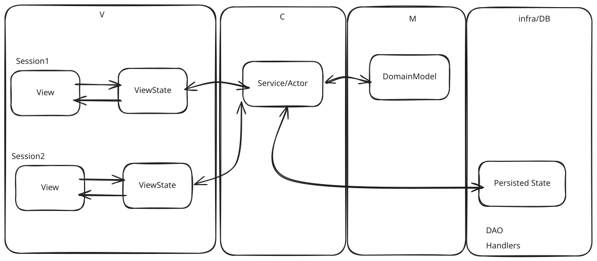

# MVC-like Example

This is just an old-fashioned example of having the front-end separate from the API-Backend. A bit like MVC: Model-View-Controller.

So every time the user want to submit data, you have to do this explicit commit to the backend.  
The backend stores, asynchronously in reality, not in this example.

I did clarify the boundaries between the projects, by having clear DTO's and objects for all the layers. Your Database-persistence layer may have DAO's.  
This leads to an extreme amount of adapters, but it is also extremely decoupled.

NB! Decoupled in TIME AND SPACE! You can swap the application for another.

## Explained

### View

The pure razor view: HTML, CSS and a bit of JavaScript if you like. Mixed in with blazor events and stuff. You know it.  
The code-behind is just there to replace the JavaScript we were used to have in an MVC razor page. That is the whole selling point of Blazor, isn't it? 

### ViewState.  
The ViewState is a model that is only used by the View. It follows the View lifecycle.  

I want it to be clear, that the ViewState here is only to be manipulated by the user. Only when the user refreshes, the page is reloaded and new information shown.  

The data in the ViewState is what is to be presented to the Controller. OR to be loaded by the controller on initialization.

In Blazor-Server it is a bit more complex in reality, because the HTML exists in the browser, and has a state that is continuously synchronized to the server over a websocket connection.  
So, for the picky ones: In reality, the ViewState does not HAVE to be the same as the HTML page, we just have to trust Blazor to do its magic. Okay?

### Service
The Service is the controller of the page in MVC. It validates and orchestrates. It has a clear boundary defined by the service interface and the data transfer objects (DTO's).

### Domain
The Model, but unlike MVC, where there are aenemic models and the business logic is kept separate, this is more like a Domain model.  
This is where the business logic lives.   
The domain model is the single source of truth. 

