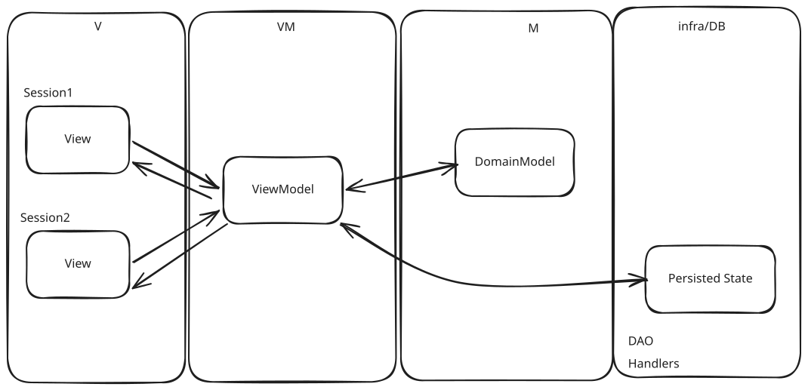

# MVVM-like Example - NO

There is no real difference between the MVC example and the MVVM example in experienced functionality.
It uses MVVM naming, but it is not truly MVVM, because the ViewModel is not tied to one view, but multiple Views.
There is only one difference, if you fill in the form, and refresh it on another browser page, the form values will be the same.

## Explained

Instead of keeping the state in a ViewState (in MVC), I kept it in the ViewModel. And since there is only one ViewModel, there should be only one state for all of the views.  
Sadly, this is not how blazor works.  
Blazor updates the session view when the state changes. It only updates other views after refresh. Not automatically. You need a subscription for that.  

In the end, it is a nice thought, but sadly, it is a dead end. I will not continue this path, but I will keep it here for reference.

### ViewModel injection

For reasons of simplification, I used a singleton ViewModel.  
However, in a real application, I wanted to control the lifetime of the ViewModel, and get it from the store.  
Since domain is my central source of truth, it is weird to have both the ViewModel centralized AND a domain model centralized. Is this not what domain events are for?

